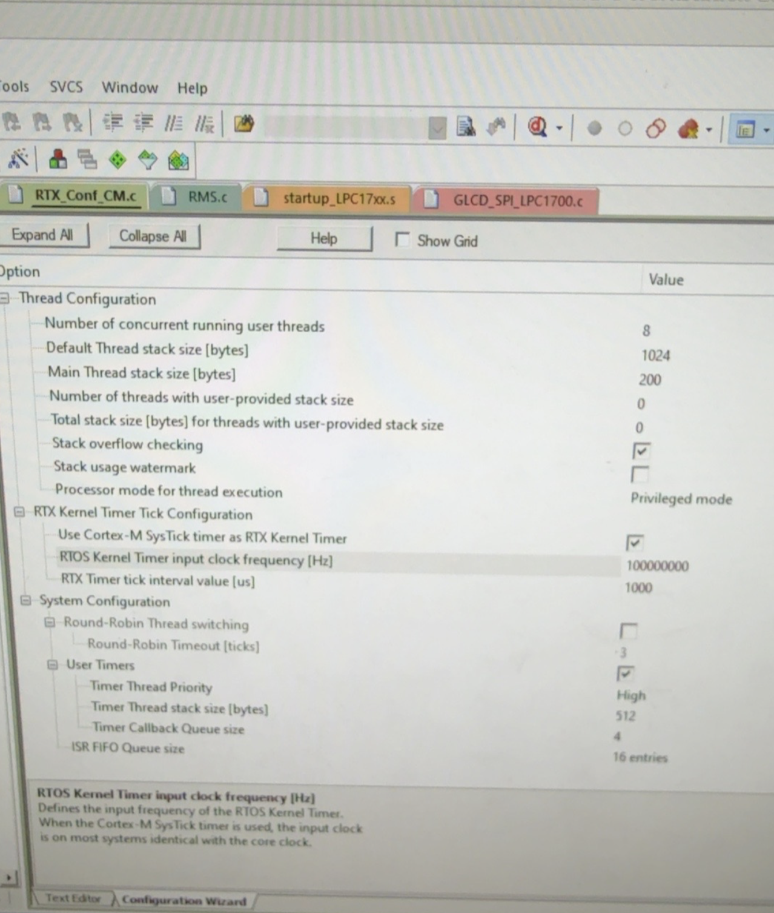
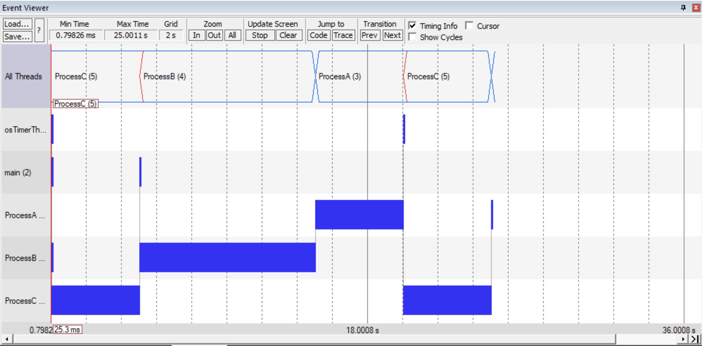
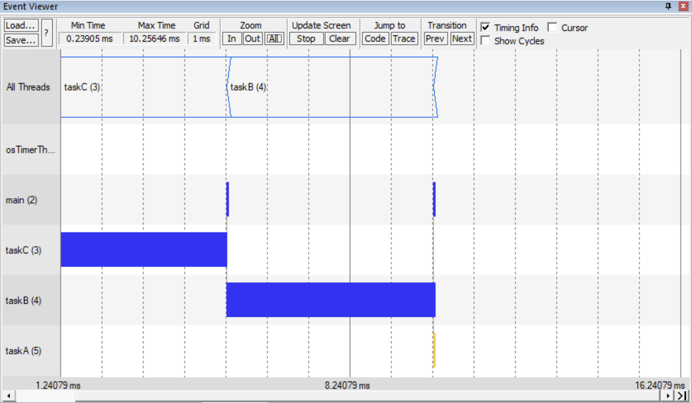
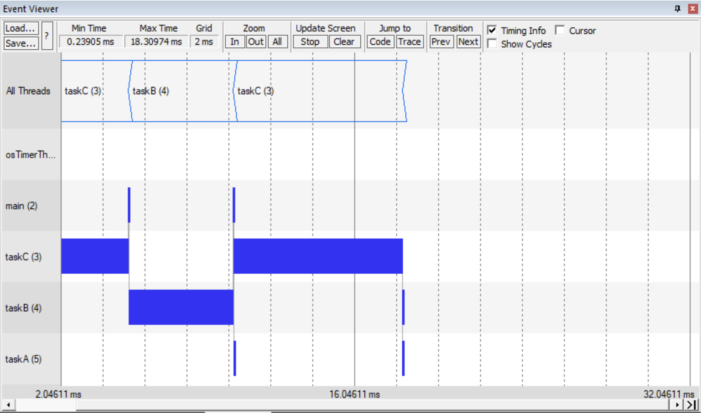

# Real-Time Scheduling and Priority Inversion

**Platform:** LPC1768 ARM Cortex-M3  
**Language:** Embedded C  
**RTOS:** CMSIS-RTX  
**Development Environment:** Keil µVision 5  
**Course:** COE718 – Embedded Systems Design  
**University:** Toronto Metropolitan University | Fall 2026

---

## Introduction

The objective of this lab was to implement real-time task scheduling and examine priority inversion using the CMSIS-RTX Real-Time Operating System (RTOS) in Keil µVision.

The first part of the lab focuses on Rate Monotonic Scheduling (RMS), where we assign periodic tasks fixed priorities based on their periods. The second part demonstrates priority inversion, where a high-priority task is delayed by a lower-priority task holding a shared resource, and examines how temporary priority elevation can resolve the issue.

---

## Methodology

### Part 1 – Rate Monotonic Scheduling

A CMSIS-RTX project was designed for three periodic tasks (A, B and C), each with a specific execution time, period, and priority.

| Task | Period (T) [ms] | Computation Time (C) [ms] | Priority Rank |
|------|-----------------|--------------------------|---------------|
| A    | 40,000          | 20,000                   | 3 (Low)       |
| B    | 40,000          | 10,000                   | 2 (Medium)    |
| C    | 20,000          | 5,000                    | 1 (High)      |

*Table 1: Task Parameters for RMS*

Task C was assigned the highest priority due to its shortest period, while Task B was assigned a higher priority than Task A as specified in the lab manual. Virtual timers and thread signals were used to control periodic task releases, while computation delays represented the execution time of each task.

### Part 2 – Priority Inversion

Priority inversion was demonstrated through three threads with high, medium and low priority. The low-priority thread received a shared resource before the high-priority thread requested it. A medium-priority thread then interrupted the low-priority thread, preventing it from releasing the resource and delaying the high-priority thread.

The program was designed to show two cases:

1. **Without priority elevation:** The medium-priority thread delays the low-priority resource holder, indirectly blocking the high-priority thread.

2. **With priority elevation:** The low-priority thread temporarily receives a higher priority, allowing it to finish using the resource and release it sooner.

This sequence was examined using the Event Viewer in Keil µVision.

### RTX Configuration

*Figure 1: RTX Configuration Wizard Settings*

Figure 1 shows the RTX Configuration Wizard settings used for this lab. The configuration includes the number of concurrent threads, thread stack sizes, RTX timer tick interval and user timer settings. These were the parameters used to ensure proper task scheduling and execution for this lab.

---

## Results

### Rate Monotonic Scheduling

*Figure 2: RMS Execution Trace*

Figure 2 shows the execution of the three tasks using Rate Monotonic Scheduling (RMS) in the RTX Event Viewer.

Task C executes first as it has the highest priority. Once it finishes its execution, Task B begins and then Task A. When Task C's next period begins, it preempts Task A since it has a higher priority.

The execution trace demonstrates how RTX schedules tasks based on their assigned priorities and allows higher-priority tasks to interrupt lower-priority tasks.

### Priority Inversion

#### Without Priority Elevation

*Figure 3: Priority Inversion Without Priority Elevation*

#### With Priority Elevation

*Figure 4: Priority Inversion Resolved Through Temporary Priority Elevation*

Figures 3 and 4 demonstrate how priority inversion works using the RTX Event Viewer.

In Figure 3, Task C executes first and holds resource R1, but gets preempted by Task B. When the higher-priority Task A preempts Task B, it becomes blocked as Task A requires the resource currently held by Task C. Since Task B has a higher priority than Task C, Task C cannot finish. This essentially keeps the system stuck on Task B.

The priority inversion solution solves this problem as shown in Figure 4. Task C's priority is temporarily increased above Task B so that it can finish its execution and free resource R1, allowing Task A to begin its execution.

The execution traces demonstrate how temporary priority elevation resolves priority inversion.

---

## Challenges

The biggest challenge I faced during this lab was configuring the RTX Configuration Wizard correctly. Initially, the tasks were not executed as expected due to incorrect configuration settings for the timer tick interval, thread stack sizes, etc.

This caused issues with task scheduling and preemption, especially in the RMS implementation. After adjusting the configuration, the tasks executed in the correct order.

---

## Conclusion

This lab examines the importance of task priorities and resource management in real-time embedded systems.

Rate Monotonic Scheduling provides a fixed-priority approach for scheduling periodic tasks, whereas priority inversion demonstrates how shared resources can interfere with expected task execution.

Temporary priority elevation can reduce this interference by temporarily giving a low-priority task a higher priority, allowing a resource-holding task to complete its critical section.

---

## References

[1] Toronto Metropolitan University, COE718 Embedded Systems Design – Lab 3b: Pre-emptive Scheduling with RTX.

